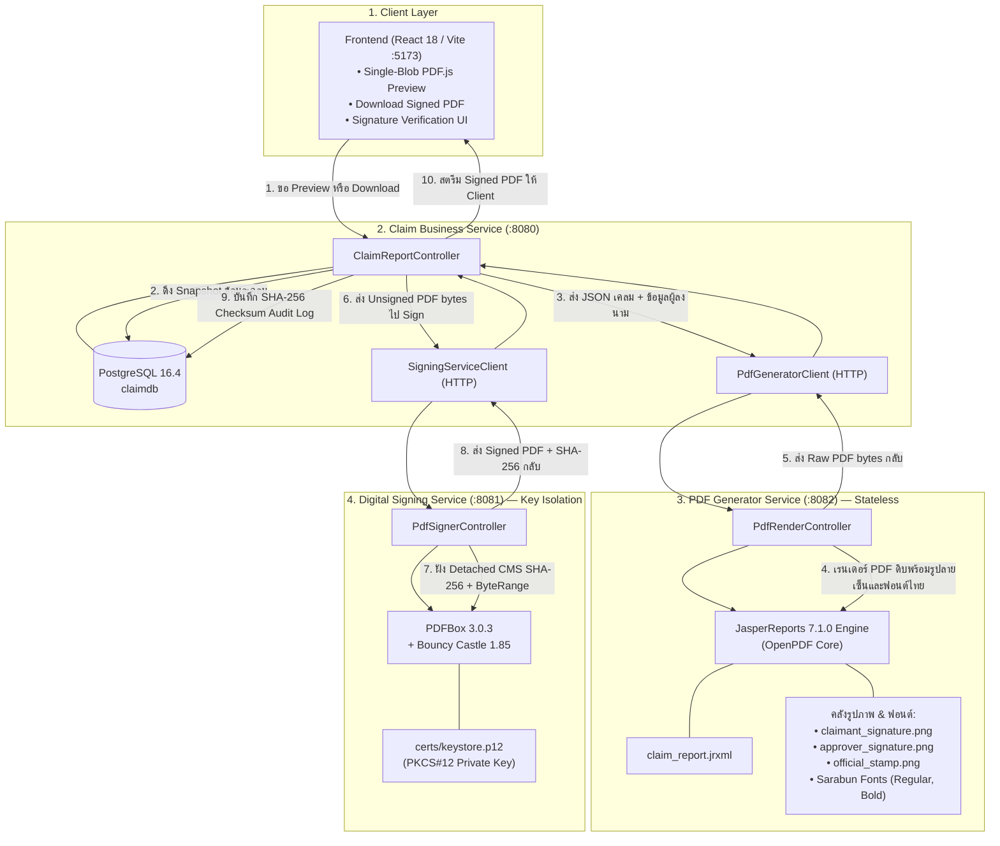

# คู่มือสถาปัตยกรรมระบบ (System Architecture Document — Claim Report 3-Tier Microservices)

เอกสารฉบับนี้อธิบายโครงสร้างสถาปัตยกรรม การแบ่งหน้าที่ (Separation of Concerns) รูปแบบการจัดการรูปภาพและฟอนต์ (Asset Management) และโมเดลความปลอดภัยของระบบออกรายงานเคลมประกันภัยและลงลายมือชื่อดิจิทัล

---

## 1. ภาพรวมสถาปัตยกรรม (High-Level Architecture)

ระบบถูกออกแบบตามหลักสถาปัตยกรรมไมโครเซอร์วิส (Microservices Architecture) เพื่อแยกภาระงานประมวลผล (Compute), งานจัดเก็บข้อมูล (Persistence), และงานความปลอดภัยทางไซเบอร์ (Security / Cryptography) ออกจากกันอย่างเด็ดขาด:



---

## 2. การแบ่งหน้าที่ของแต่ละ Service (Separation of Concerns)

| บริการ (Service) | พอร์ต (Port) | หน้าที่และความรับผิดชอบ | ข้อมูล/ไฟล์ที่ถือครอง |
| :--- | :---: | :--- | :--- |
| **`claim-report-backend`**<br>(Business Core) | `8080` | • ให้บริการ REST API สำหรับ Frontend<br>• จัดการวงจรชีวิตของเคลม, การสร้างเวอร์ชันใหม่ (Snapshot Versioning)<br>• ประสานงาน (Orchestrator) ระหว่าง Jasper และ Signer Service<br>• บันทึก Audit Log ของค่า SHA-256 Checksum ลงใน PostgreSQL | • ฐานข้อมูล PostgreSQL (`claims`, `claim_snapshots`, `report_audit_logs`)<br>• *ไม่มีสิทธิ์เข้าถึง Private Key และไม่มี Jasper Engine* |
| **`pdf-generator-service`**<br>(Jasper & Assets) | `8082` | • รับ JSON ข้อมูลเคลม เรนเดอร์เป็น Unsigned PDF ในหน่วยความจำ<br>• จัดการ Layout หน้ากระดาษ, ฟอนต์ภาษาไทยสารบรรณ, และตารางข้อมูล<br>• **จัดเก็บและเรนเดอร์รูปภาพ (ภาพลายเซ็นผู้เอาประกัน, ภาพลายเซ็นผู้อนุมัติ, ตรายางบริษัท)**<br>• เป็น **Stateless Compute Service** สามารถ Scale-Out ตามโหลด CPU ได้ทันที | • `reports/claim_report.jrxml`<br>• `images/claimant_signature.png`<br>• `images/approver_signature.png`<br>• `images/official_stamp.png`<br>• `fonts/Sarabun-*.ttf` |
| **`digital-signing-service`**<br>(Security & Detached CMS) | `8081` | • ทำงานใน **Isolated Security Zone**<br>• รับ Unsigned PDF bytes มาสร้าง `PDSignature` และคำนวณ `ByteRange`<br>• นำ Private Key มาเข้ารหัสสร้าง **Detached CMS Signature (`/adbe.pkcs7.detached`, SHA-256 with RSA 2048-bit)**<br>• ตรวจสอบความถูกต้องของลายเซ็น (Verify) และจำลองการปลอมแปลง (Tamper Demo) | • `certs/keystore.p12` (Private Key & Certificate Chain)<br>• Apache PDFBox 3.0.3<br>• Bouncy Castle 1.85 |
| **`frontend`**<br>(UI Client) | `5173` | • แสดงผลรายการเคลมและประวัติเวอร์ชัน<br>• Single-Blob Fetch: แสดงตัวอย่างผ่าน PDF.js และดาวน์โหลดไฟล์จริง<br>• ตรวจสอบลายเซ็นดิจิทัลและจำลองการ Tamper Test | • React 18, TypeScript, Tailwind CSS, PDF.js |

---

## 3. รูปแบบการจัดการรูปภาพและฟอนต์ (Asset Management Strategy)

ตามหลักการออกแบบสถาปัตยกรรมที่ดี **รูปภาพและฟอนต์ทั้งหมดที่เกี่ยวข้องกับการเรนเดอร์เอกสาร PDF ถูกนำมาไว้ที่ `pdf-generator-service`** โดยมีรายละเอียดดังนี้:

### 3.1 คลังรูปภาพใน Service (`src/main/resources/images/`)
1. **`claimant_signature.png`**:
   - ภาพลายเซ็นเสมือนของผู้เอาประกัน (ลายเซ็นสีน้ำเงิน พื้นหลังโปร่งแสง Transparent PNG)
   - ขนาด: กว้าง 300 x สูง 100 พิกเซล
   - จัดวางในช่อง "ผู้เอาประกันภัย / ผู้เรียกร้องค่าสินไหม" บนหน้า 2 ของรายงาน
2. **`approver_signature.png`**:
   - ภาพลายเซ็นของผู้อำนวยการฝ่ายพิจารณาสินไหมทดแทน (ลายเซ็นสีเขียวเข้ม พื้นหลังโปร่งแสง)
   - ขนาด: กว้าง 300 x สูง 100 พิกเซล
   - จัดวางในกรอบ "ผู้มีอำนาจลงนามและอนุมัติฝ่ายสินไหมทดแทน" บนหน้า 2 ของรายงาน
3. **`official_stamp.png`**:
   - ภาพตรายางรับรองบริษัท (Official Approval Stamp Badge ขอบสองชั้นสีแดงเข้ม พื้นหลังโปร่งแสง)
   - ขนาด: กว้าง 160 x สูง 160 พิกเซล
   - จัดวางเคียงข้างบล็อกรับรองความสมบูรณ์ทางดิจิทัล

### 3.2 Dynamic Override Support
- `claim_report.jrxml` รองรับทั้งการดึงภาพมาตรฐานจากคลัง Resource ของ Service อัตโนมัติ หรือหากในอนาคตต้องการให้อัปโหลดลายเซ็นสดของผู้เคลม ก็สามารถส่งเป็นสตริง Base64 ผ่าน `customClaimantSignatureBase64` เพื่อ Override ได้ทันที

---

## 4. API Contract ระหว่าง Microservices

### 4.1 `pdf-generator-service` (:8082)
* **`POST /api/v1/pdf/render-claim-report`**
  - **Request Body (JSON):**
    ```json
    {
      "payload": {
        "reportId": "UUID",
        "claimNumber": "CLM-2026-0001",
        "policyNumber": "POL-TH-884920",
        "claimantName": "นายสมชาย ใจดี",
        "incidentDate": "15 ตุลาคม 2569 เวลา 09:30 น.",
        "incidentDescription": "...",
        "hospitalOrGarage": "...",
        "version": 1,
        "snapshotCreatedAt": "2026-10-17 14:00:00 ICT",
        "items": [
          { "description": "...", "category": "...", "amount": 18500.00 }
        ],
        "totalAmount": 45000.00
      },
      "signerSubject": "CN=Claim Report PoC Signer,...",
      "customClaimantSignatureBase64": null,
      "customApproverSignatureBase64": null
    }
    ```
  - **Response (200 OK):**
    - `Content-Type: application/pdf`
    - `Body: <Raw Unsigned PDF bytes>`

---

### 4.2 `digital-signing-service` (:8081)
* **`POST /api/v1/signatures/sign`**
  - **Request Body:** `<Raw Unsigned PDF bytes>`
  - **Headers:**
    - `X-Claim-Number: CLM-2026-0001`
    - `X-Claim-Version: 1`
  - **Response (200 OK):**
    - `Content-Type: application/pdf`
    - `X-Report-SHA256: <64-character hex hash>`
    - `X-Signer-Subject: <Certificate Subject DN>`
    - `Body: <Signed PDF bytes>`
* **`POST /api/v1/signatures/verify-direct`**
  - **Request Body:** `<PDF bytes>`
  - **Response (200 OK):**
    ```json
    {
      "isValid": true,
      "isTampered": false,
      "signatureFound": true,
      "filter": "Adobe.PPKLite",
      "subFilter": "adbe.pkcs7.detached",
      "digestAlgorithmOid": "2.16.840.1.101.3.4.2.1",
      "signerSubject": "CN=Claim Report PoC Signer,...",
      "coversWholeDocument": true,
      "byteRange": [0, 23612, 42558, 928],
      "fileSha256": "...",
      "message": "ตรวจสอบสำเร็จ: ลายเซ็นดิจิทัลถูกต้อง (VALID)..."
    }
    ```
* **`POST /api/v1/signatures/tamper-demo-direct`**
  - **Request Body:** `<Signed PDF bytes>`
  - **Response (200 OK):** `<Tampered 1-byte PDF bytes>`

---

## 5. โมเดลความปลอดภัย (Security Architecture & Isolation)

1. **Principle of Least Privilege & Key Isolation:**
   - คอนเทนเนอร์ `signing-service` เป็นคอนเทนเนอร์เดียวที่มีสิทธิ์เข้าถึงไดเรกทอรี `./certs` ผ่านการ Mount แบบ `:ro` (Read-Only)
   - คอนเทนเนอร์ `backend` และ `pdf-generator-service` ไม่มีสิทธิ์เข้าถึง Private Key หรือ Keystore Password
2. **Denial of Service (DoS) Defense:**
   - การประมวลผลเรนเดอร์ PDF ซึ่งใช้ทรัพยากร CPU และ Memory สูง ถูกกักบริเวณไว้ใน `pdf-generator-service` ทำให้ไม่สามารถทำให้ Database Connection หรือ Core Claim Business Service หยุดชะงักได้
3. **100% Zero Vulnerability Enforcement:**
   - ทุกโมดูลผ่านการตรวจสอบความปลอดภัยด้วย **Trivy Scanner (0 Vulnerabilities across all pom.xml & package-lock.json)**
   - ปิดกั้น iText เก่า และตรึงเวอร์ชัน Tomcat Embed, Jackson, Bouncy Castle, และ Apache Commons BeanUtils ในระดับ Dependency Management
