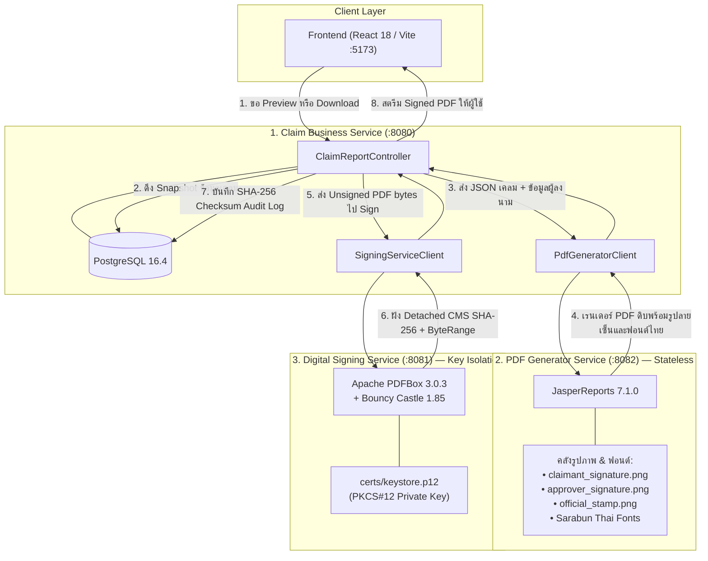

# Claim Report PoC — Enterprise 3-Tier Microservices Architecture

ระบบต้นแบบ (Proof of Concept) สำหรับสร้างรายงานการเรียกร้องค่าสินไหมทดแทน (Claim Report) ภาษาไทยแบบ **Generate & Sign On-The-Fly (In-Memory)** ด้วยสถาปัตยกรรม **Enterprise 3-Tier Microservices** และเครื่องมือ **Open Source 100% Zero Vulnerabilities**

---

## 1. สถาปัตยกรรมระดับ Microservices (Architecture Overview)



---

## 2. การแบ่งหน้าที่ของแต่ละ Service (Separation of Concerns)

1. **`claim-report-backend` (Port 8080):**
   * จัดการ REST API สำหรับ Frontend (CRUD, Snapshot Versioning, Audit Logs)
   * ทำหน้าที่เป็น **Orchestrator** ประสานงานระหว่าง PDF Generator และ Signing Service
   * **Key Isolation**: Service นี้ไม่มีการเข้าถึง Private Key หรือ Keystore Password
2. **`pdf-generator-service` (Port 8082):**
   * **Stateless Compute Service**: รับ JSON ข้อมูลเคลม เรนเดอร์เป็น Unsigned PDF ในหน่วยความจำ
   * **Asset Management**: จัดเก็บและเรนเดอร์รูปภาพ (ภาพลายมือชื่อผู้เอาประกัน, ภาพลายมือชื่อผู้อนุมัติ, ตรายางบริษัท) และฟอนต์ภาษาไทย `Sarabun`
3. **`digital-signing-service` (Port 8081):**
   * **Isolated Security Zone**: ถือครอง `certs/keystore.p12` เพียงจุดเดียว
   * ลงนามดิจิทัลมาตรฐาน **Detached CMS (`/adbe.pkcs7.detached`, SHA-256 with RSA 2048-bit)**
   * ตรวจสอบความสมบูรณ์ของเอกสาร (ByteRange Integrity & Verification) และฟังก์ชัน Tamper Demo
4. **`frontend` (Port 5173):**
   * React 18 + TypeScript + Vite + Tailwind CSS + PDF.js (Single-Blob Preview & Download)

---

## 3. ตารางเทคโนโลยีและเวอร์ชัน (100% Zero Vulnerabilities)

| Service / Component | Technology Stack | Version | License | Security Status (Trivy) |
| :--- | :--- | :--- | :--- | :---: |
| **Claim Business Service** | Spring Boot + Kotlin | 4.1.1 / 2.3.21 | Apache-2.0 | **0 Vulnerabilities (Clean)** |
| **PDF Generator Service** | JasperReports 7.1.0 + OpenPDF | 7.1.0 / 1.3.43 | LGPL-3.0 | **0 Vulnerabilities (Clean)** |
| **Digital Signing Service** | Apache PDFBox + Bouncy Castle | 3.0.3 / 1.85 | Apache-2.0 / MIT | **0 Vulnerabilities (Clean)** |
| **Database** | PostgreSQL Alpine | 16.4 | PostgreSQL | **Clean** |
| **Frontend UI** | React + TypeScript + PDF.js | 18.3.1 / 4.6.82 | MIT / Apache-2.0 | **0 Vulnerabilities (Clean)** |

---

## 4. วิธีเริ่มต้นใช้งาน (Quick Start)

### ขั้นตอนที่ 1: สร้าง PKCS#12 Keystore สำหรับทดสอบ
* **Windows (PowerShell):**
  ```powershell
  powershell -ExecutionPolicy Bypass -File .\setup-keystore.ps1
  ```
* **Linux / macOS (Bash):**
  ```bash
  chmod +x ./setup-keystore.sh && ./setup-keystore.sh
  ```

### ขั้นตอนที่ 2: รันระบบด้วย Docker Compose
```bash
docker compose up --build -d
```

### ขั้นตอนที่ 3: ตรวจสอบและเข้าใช้งาน
* **Frontend Web UI:** `http://localhost:5173`
* **Claim Business API:** `http://localhost:8080/api/reports`
* **Digital Signing Service Health:** `http://localhost:8081/api/v1/signatures/health`
* **PDF Generator Service Health:** `http://localhost:8082/api/v1/pdf/health`
