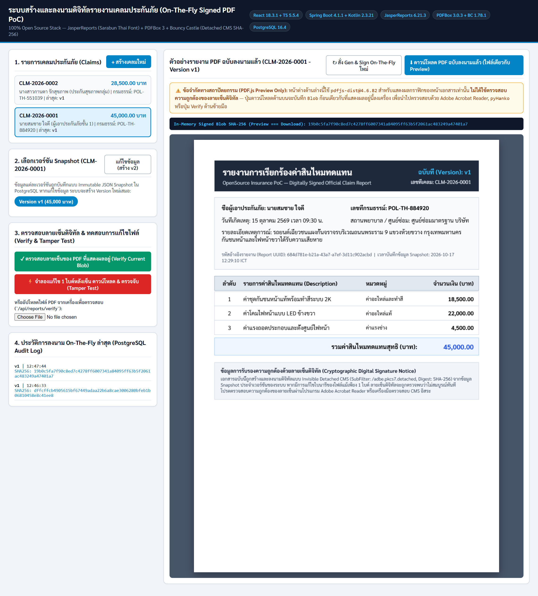
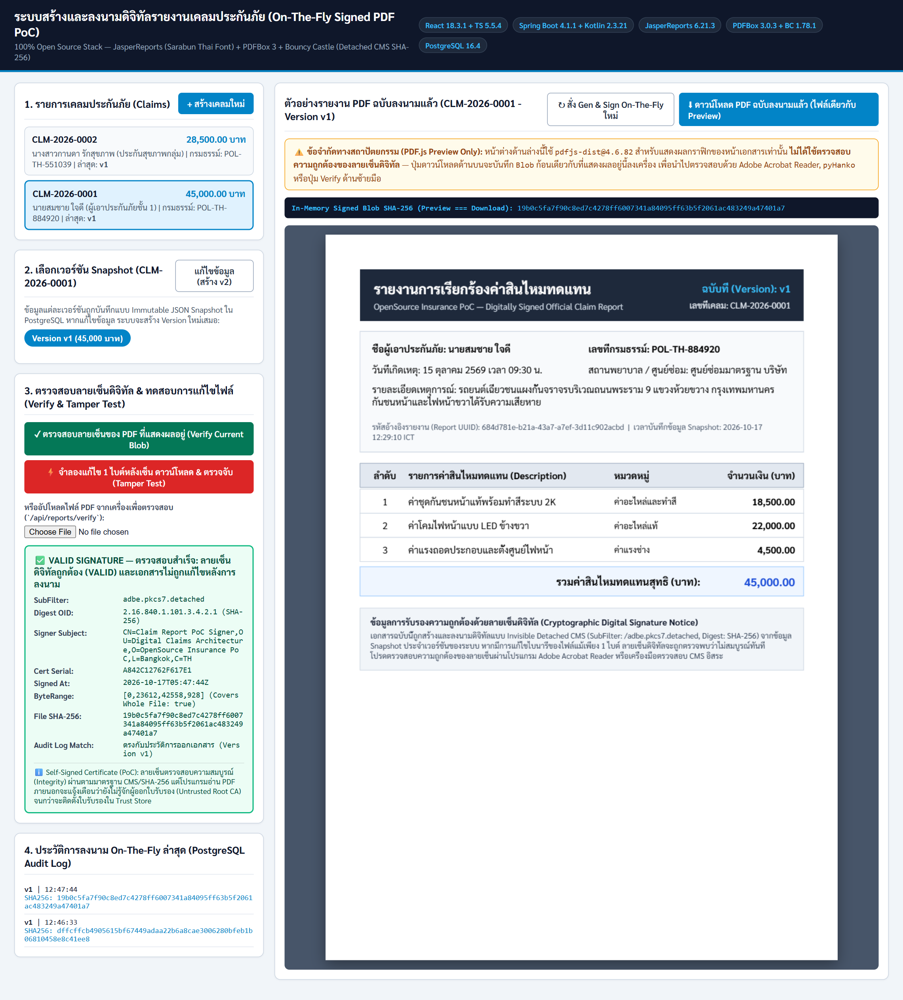
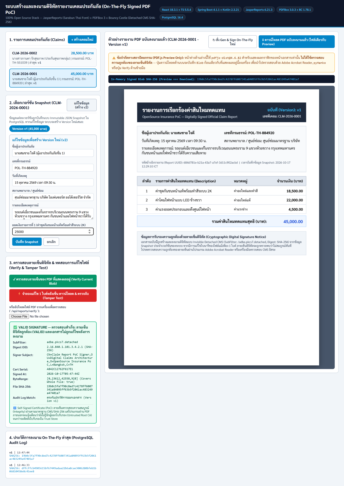
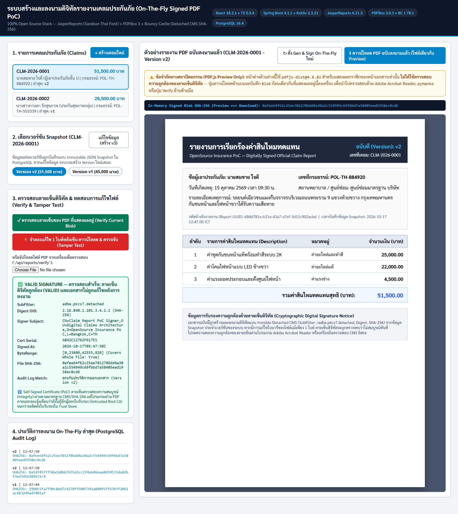
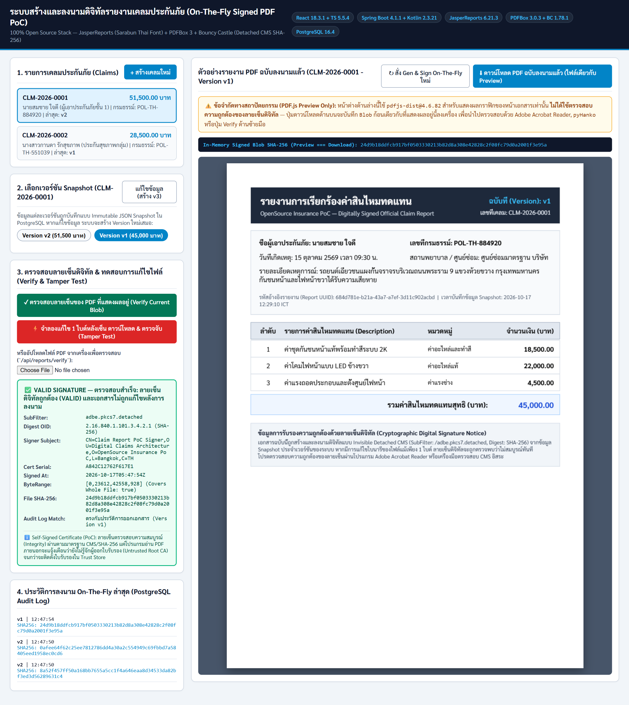
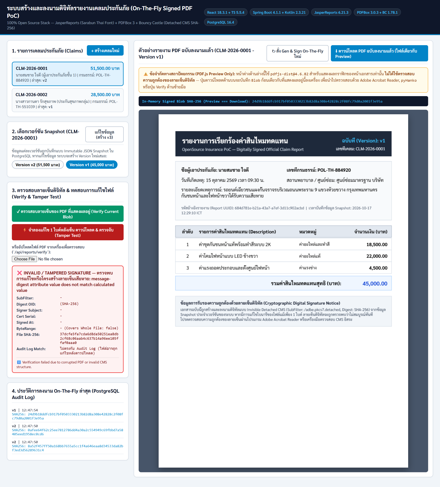
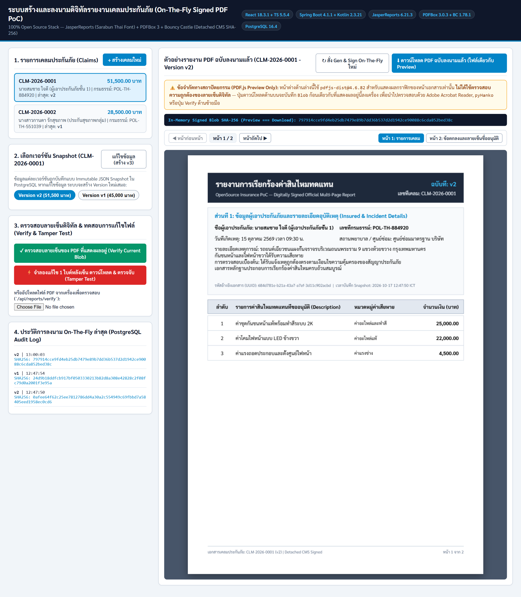
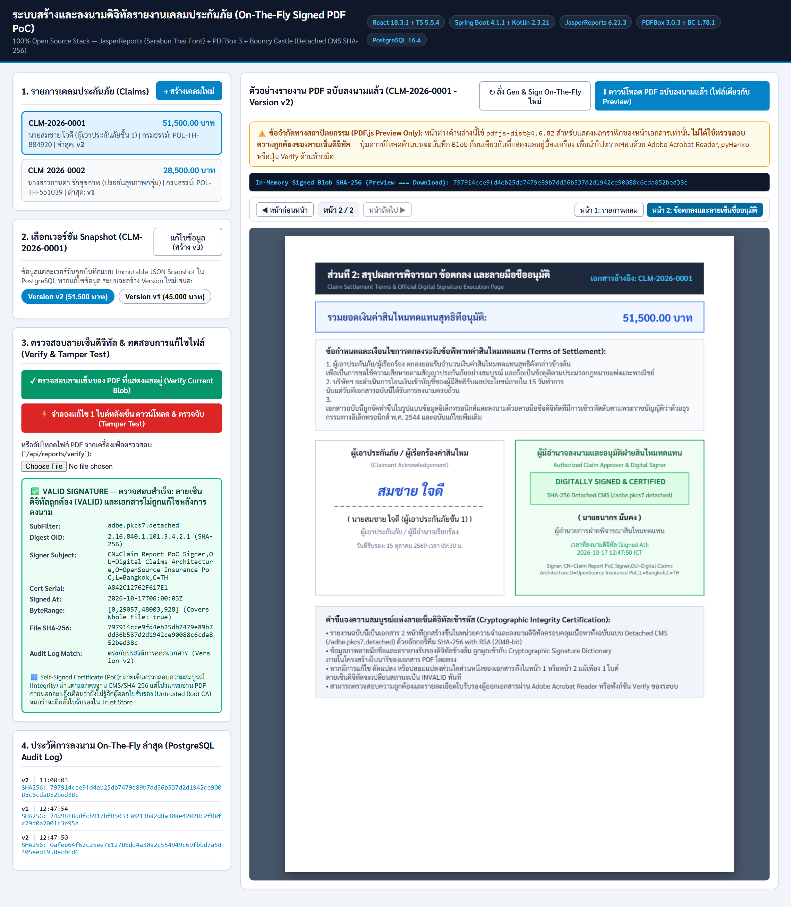

# รายงานผลการทดสอบระบบ (User Acceptance Test Report — Claim Report PoC)

* **วันที่ดำเนินการทดสอบ:** 17 ตุลาคม 2569 (2026-10-17)
* **สภาพแวดล้อม (Environment):** 3-Tier Microservices บน Docker Compose (`React 18.3.1 + TS 5.5.4`, `Claim Business Core :8080`, `Stateless Jasper PDF Generator with Image Assets :8082`, `Isolated Digital Signing Service :8081`, `PostgreSQL 16.4`)
* **สรุปผลการทดสอบ:** **ผ่านทั้งหมด 6 / 6 Test Cases (100% PASS)**

---

## ตารางสรุป User Test Cases (UAT Summary Matrix)

| รหัส (ID) | ชื่อกรณีทดสอบ (Test Case Title) | วัตถุประสงค์และข้อกำหนดที่ตรวจสอบ | ผลลัพธ์คาดหวัง (Expected Result) | ผลลัพธ์จริง (Actual Result) | สถานะ |
| :--- | :--- | :--- | :--- | :--- | :---: |
| **TC-01** | **การสร้างและแสดงตัวอย่าง PDF ภาษาไทยแบบ On-The-Fly (Single-Blob Fetch)** | ทดสอบ JasperReports ฝังฟอนต์ไทย `Sarabun` + ลงนามในหน่วยความจำ + แสดงผลผ่าน `PDF.js` โดยใช้ `Blob` ก้อนเดียวกับปุ่ม Download | หน้าเอกสารแสดงฟอนต์ภาษาไทยถูกต้องไม่เพี้ยน แสดงคำเตือนข้อจำกัดของ `PDF.js` และแสดงค่า `SHA-256` ของ `Blob` ที่พร้อมดาวน์โหลด | แสดงรายงาน `CLM-2026-0001 (v1)` ยอดรวม `45,000.00` บาท พร้อม `SHA-256: 19b0c5fa...7401a7` | **PASS** |
| **TC-02** | **การตรวจสอบความถูกต้องของลายเซ็นดิจิทัล (Valid Detached CMS Verification)** | ทดสอบ Invisible Signature (`/adbe.pkcs7.detached`, `SHA-256`) และการตรวจสอบกับใบรับรอง X.509 ที่ฝังใน CMS รวมถึงการเทียบกับ PostgreSQL Audit Log | ระบบรายงาน `VALID SIGNATURE` ระบุ `SubFilter: adbe.pkcs7.detached`, `Covers Whole File: true` และตรงกับ Audit Log ของ `v1` | `isValid = true`, `isTampered = false`, `ByteRange: [0, 23612, 42558, 928]`, ตรงกับ Audit Log `v1` | **PASS** |
| **TC-03** | **การแก้ไขข้อมูลเคลมเพื่อสร้างเวอร์ชันใหม่ (Immutable Snapshot Versioning — Create v2)** | ทดสอบข้อกำหนด "ลงนามครั้งเดียวต่อ report version; หากข้อมูลเปลี่ยน ให้สร้าง versionใหม่" | เมื่อแก้ยอดเงินรายการที่ 1 จาก `18,500` เป็น `25,000` บาท ระบบต้องสร้าง `Version v2` (ยอดรวม `51,500.00` บาท) ลงนามใหม่ และบันทึก Audit Log ของ `v2` | สร้าง `Version v2` สำเร็จ (`SHA-256: 0afee64f...ec0cd6`) และตรวจสอบลายเซ็น `v2` ผ่าน (`VALID`) | **PASS** |
| **TC-04** | **การสลับกลับไปเรียกดูเวอร์ชันเดิม (Frozen Snapshot Integrity — Switch back to v1)** | ทดสอบว่าข้อมูลของ `Version v1` ไม่ถูกเขียนทับหลังสร้าง `Version v2` | เมื่อคลิกเลือก `Version v1 (45,000 บาท)` หน้าเอกสารต้องแสดงยอด `45,000.00` บาทตาม Snapshot เดิมของ `v1` และตรวจลายเซ็นผ่าน | แสดงข้อมูล `Version v1` (`45,000.00` บาท) ถูกต้อง และตรวจลายเซ็นผ่าน (`VALID`) | **PASS** |
| **TC-05** | **การตรวจจับการแก้ไขไฟล์ PDF หลังการลงนาม (Post-Signing Tamper Detection)** | ทดสอบการดัดแปลงไบนารีใน PDF หลังลงนามแล้วส่งตรวจสอบความสมบูรณ์ของลายเซ็น | ระบบต้องปฏิเสธความถูกต้อง (`INVALID / TAMPERED SIGNATURE`) เนื่องจากค่า `SHA-256 message-digest` ไม่ตรงกับข้อมูลใน `/ByteRange` และไม่ตรงกับ Audit Log | แสดง `❌ INVALID / TAMPERED SIGNATURE` (`message-digest attribute value does not match calculated value`) | **PASS** |
| **TC-06** | **รายงานเคลมแบบหลายหน้า (> 1 หน้า) พร้อมลายเซ็นภาพและตราประทับดิจิทัล (Multi-Page & Visual Signatures)** | ทดสอบการจัดโครงสร้างรายงาน JasperReports ให้มีมากกว่า 1 หน้า พร้อมลายมือชื่อภาพของผู้เอาประกัน (Claimant Signature) ตราประทับดิจิทัลของผู้อนุมัติ (Digital Certified Stamp Badge) และลงนามดิจิทัล CMS ครอบคลุมทั้งฉบับ | เอกสารแยกเป็น 2 หน้า (หน้า 1: รายการความเสียหาย, หน้า 2: เงื่อนไขและลายเซ็นภาพ 2 ส่วน) พร้อมทั้งมีปุ่มเปิดเปลี่ยนหน้าบน UI และลายเซ็นดิจิทัล detached CMS ถูกต้องสมบูรณ์ครอบคลุมทั้ง 2 หน้า | หน้าเอกสารแบ่ง 2 หน้าอย่างสมบูรณ์ หน้าที่ 2 มีลายเซ็นภาพผู้เรียกร้องและตราประทับดิจิทัลของระบบ และตรวจลายเซ็นดิจิทัลผ่าน (`VALID`, `adbe.pkcs7.detached`, ครอบคลุมทั้งไฟล์) | **PASS** |

---

## รายละเอียดผลการทดสอบและภาพหน้าจอ (Detailed Execution & Screenshots)

### TC-01: การสร้างและแสดงตัวอย่าง PDF ภาษาไทยแบบ On-The-Fly (Single-Blob Fetch)
* **ขั้นตอนทดสอบ:**
  1. เปิดเบราว์เซอร์ไปที่ `http://localhost:5173`
  2. เลือกรายการเคลม `CLM-2026-0001` (`นายสมชาย ใจดี`)
* **ผลลัพธ์ที่ได้:**
  * Backend สร้าง PDF ภาษาไทยด้วยฟอนต์ `Sarabun` (`Identity-H`) และลงนามในหน่วยความจำ
  * Frontend รับข้อมูลเป็น `Blob` ก้อนเดียว (`SHA-256: 19b0c5fa7f90c8ed7c4278ff6007341a84095ff63b5f2061ac483249a47401a7`) แสดงผลบน `<canvas>` ของ `pdfjs-dist@4.6.82` และผูกปุ่มดาวน์โหลดเข้ากับ `Blob` เดียวกัน
* **ภาพหน้าจอ:**
  

---

### TC-02: การตรวจสอบความถูกต้องของลายเซ็นดิจิทัล (Valid Detached CMS Verification)
* **ขั้นตอนทดสอบ:**
  1. คลิกปุ่ม **"✓ ตรวจสอบลายเซ็นของ PDF ที่แสดงผลอยู่ (Verify Current Blob)"**
* **ผลลัพธ์ที่ได้:**
  * `Status`: `✅ VALID SIGNATURE — ตรวจสอบสำเร็จ: ลายเซ็นดิจิทัลถูกต้อง (VALID) และเอกสารไม่ถูกแก้ไขหลังการลงนาม`
  * `SubFilter`: `adbe.pkcs7.detached`
  * `Digest OID`: `2.16.840.1.101.3.4.2.1 (SHA-256)`
  * `Signer Subject`: `CN=Claim Report PoC Signer,OU=Digital Claims Architecture,O=OpenSource Insurance PoC,L=Bangkok,C=TH`
  * `ByteRange`: `[0, 23612, 42558, 928] (Covers Whole File: true)`
  * `File SHA-256`: `19b0c5fa7f90c8ed7c4278ff6007341a84095ff63b5f2061ac483249a47401a7`
  * `Audit Log Match`: `ตรงกับประวัติการออกเอกสาร (Version v1)`
* **ภาพหน้าจอ:**
  

---

### TC-03: การแก้ไขข้อมูลเคลมเพื่อสร้างเวอร์ชันใหม่ (Immutable Snapshot Versioning — Create v2)
* **ขั้นตอนทดสอบ:**
  1. คลิกปุ่ม **"แก้ไขข้อมูล (สร้าง v2)"**
  2. แก้ไขยอดเงินรายการที่ 1 (`ค่าชุดกันชนหน้าแท้พร้อมทำสีระบบ 2K`) จาก `18500` เป็น `25000` บาท แล้วกด **"บันทึก Snapshot"**
  3. คลิกปุ่ม **"✓ ตรวจสอบลายเซ็นของ PDF ที่แสดงผลอยู่"** สำหรับ `Version v2`
* **ผลลัพธ์ที่ได้:**
  * ระบบสร้าง Snapshot `Version v2` ใหม่ ยอดรวมสุทธิเปลี่ยนเป็น `51,500.00` บาท
  * บนหัวกระดาษ PDF ระบุ `ฉบับที่ (Version): v2`
  * ลายเซ็นดิจิทัลของ `v2` มีค่า `SHA-256: 0afee64f62c25ee7812786dd4a30a2c554949c69fbbd7a58405eed1958ec0cd6` ตรวจสอบผ่าน (`VALID`) และตรงกับ Audit Log ของ `Version v2`
* **ภาพหน้าจอ:**
  
  

---

### TC-04: การสลับกลับไปเรียกดูเวอร์ชันเดิม (Frozen Snapshot Integrity — Switch back to v1)
* **ขั้นตอนทดสอบ:**
  1. คลิกสลับกลับไปที่ปุ่ม **`Version v1 (45,000 บาท)`**
  2. คลิกปุ่ม **"✓ ตรวจสอบลายเซ็นของ PDF ที่แสดงผลอยู่"**
* **ผลลัพธ์ที่ได้:**
  * รายงานกลับมาแสดงข้อมูลของ `Version v1` (รายการที่ 1 = `18,500.00` บาท, ยอดรวม = `45,000.00` บาท) โดยไม่ถูกกระทบจากการแก้ไขใน `Version v2`
  * ตรวจสอบลายเซ็นผ่าน (`VALID`) และตรงกับ Audit Log ของ `Version v1` (`SHA-256: 24d9b18ddfcb917bf0503330213b82d8a308e42828c2f08fc79d0a2001f3e95a`)
* **ภาพหน้าจอ:**
  

---

### TC-05: การตรวจจับการแก้ไขไฟล์ PDF หลังการลงนาม (Post-Signing Tamper Detection)
* **ขั้นตอนทดสอบ:**
  1. คลิกปุ่ม **"⚡ จำลองแก้ไข 1 ไบต์หลังเซ็น ดาวน์โหลด & ตรวจจับ (Tamper Test)"**
* **ผลลัพธ์ที่ได้:**
  * ระบบแก้ไขไบนารีภายในช่วง `/ByteRange` ของไฟล์ที่ลงนามแล้ว ดาวน์โหลดไฟล์ `-TAMPERED.pdf` และส่งเข้าตรวจสอบที่ `/api/reports/verify`
  * ระบบตรวจพบการปลอมแปลงและปฏิเสธทันที:
    * `Status`: `❌ INVALID / TAMPERED SIGNATURE — ตรวจพบการแก้ไขหรือโครงสร้างลายเซ็นเสียหาย: message-digest attribute value does not match calculated value`
    * `File SHA-256`: `37dcfe5fa7cda6d8da50251ea8db2cf68c06aab4c637b14a96ee105ffaf0aaa0`
    * `Audit Log Match`: `ไม่ตรงกับ Audit Log (ไฟล์อาจถูกแก้ไขหลังดาวน์โหลด)`
* **ภาพหน้าจอ:**
  

---

### TC-06: รายงานเคลมแบบหลายหน้า (> 1 หน้า) พร้อมลายเซ็นภาพและตราประทับดิจิทัล (Multi-Page & Visual Signatures)
* **ขั้นตอนทดสอบ:**
  1. เปิดเบราว์เซอร์ไปที่ `http://localhost:5173`
  2. สังเกตแถบ Pagination Tool: `หน้า 1 จาก 2`
  3. คลิกปุ่ม **"หน้าถัดไป >"** หรือปุ่ม **"หน้า 2"** เพื่อไปยังหน้าที่ 2
  4. คลิกปุ่ม **"✓ ตรวจสอบลายเซ็นของ PDF ที่แสดงผลอยู่"**
* **ผลลัพธ์ที่ได้:**
  * **หน้า 1 (Page 1):** แสดงข้อมูลเลขที่เคลม, กรมธรรม์, ผู้เอาประกันภัย, เหตุการณ์ความเสียหาย, และตารางรายการอะไหล่/ค่าแรง (ยอดรวม `45,000.00` บาท) ระบุ `หน้า 1 จาก 2`
  * **หน้า 2 (Page 2):** แสดงข้อกำหนดและเงื่อนไขการยินยอมระงับข้อพิพาท พร้อมลายเซ็น 2 ส่วน:
    1. **ลายมือชื่อภาพผู้เอาประกัน (Claimant Signature):** ลายเซ็นจำลองหวัดสวยงาม `สมชาย ใจดี` พร้อมช่องกรอกวันที่
    2. **ตราประทับลายเซ็นดิจิทัลทางการ (Official Approver Digital Certified Stamp):** ตราประทับขอบสองชั้นสีน้ำเงินเข้ม แสดงสถานะ `DIGITALLY SIGNED & CERTIFIED`, Issuer/Subject, อัลกอริทึม `SHA256withRSA (2048-bit)` และข้อความระบุการลงนามแบบเข้ารหัส CMS
  * **การลงนามดิจิทัล (Cryptographic Verification):**
    * `Status`: `✅ VALID SIGNATURE`
    * ลายเซ็นครอบคลุมทั้งเอกสาร 2 หน้าอย่างสมบูรณ์ (`Covers Whole File: true`, `adbe.pkcs7.detached`)
* **ภาพหน้าจอ:**
  * **หน้า 1 (Claim Details & Items):**
    
  * **หน้า 2 (Visual Signatures & Approval Stamp):**
    

